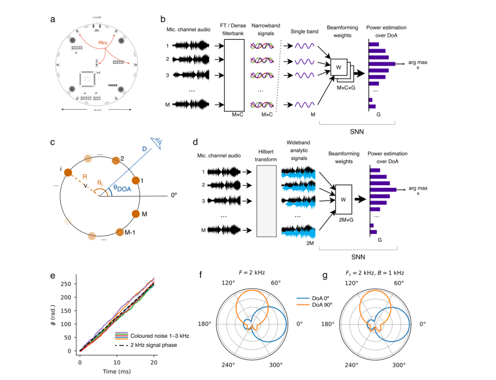
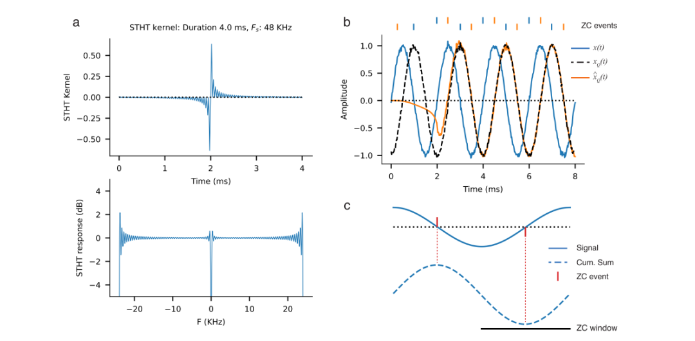
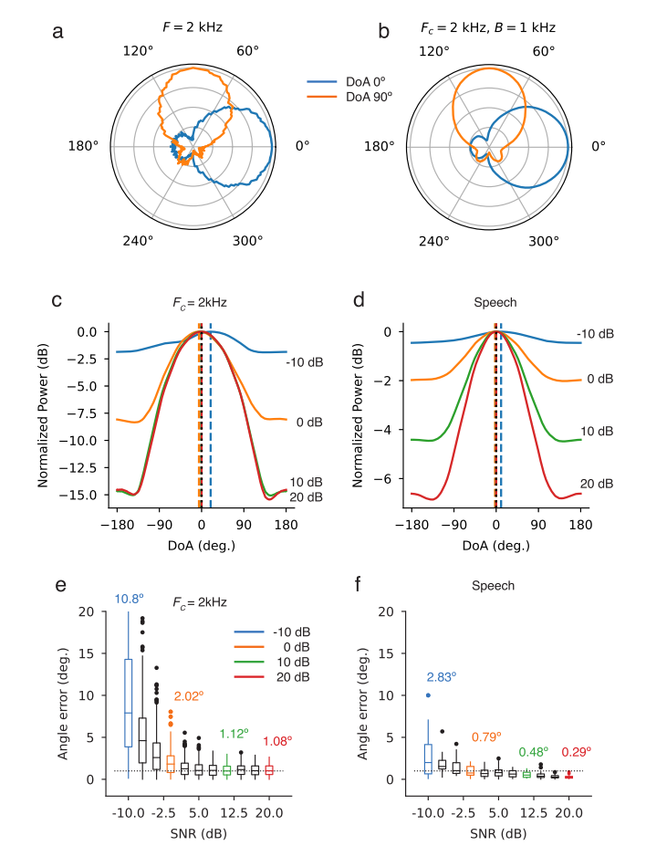

# [Sound Source Localization]Low Power SNN-based Audio Source Localization Using Hilbert Transform Peak Codes with Hilbert Transform Peak Codes

Introduction: Recognizing the source from the received signal in an array of sensors, which is a crucial issue in signal processing, appears in many applications such as target detection in radar, user tracking in wireless systems, indoor presence detection, virtual reality, consumer audio, etc. Positioning is a well-known classic problem and has been widely studied in literature.
A common method to estimate the source's position or arrival direction (DoA) based on the received signals in the array is to apply reverse beamforming to the incident signal. Reverse beamforming combines the received array signals in the time domain or frequency domain according to the signal propagation model to "guide" the array towards the assumed target. Then, the true DoA of the audio source can be estimated by identifying the input direction that gives the highest power in the manipulated microphone array. The superresolution methods used for DoA estimation (such as MUSIC 4 and ESPRIT 5) are one of the latest approaches to employ reverse beamforming. Besides source positioning, various forms of beamforming also appear as the first stage of spatial signal processing in applications like cocktail party problems for audio source separation 6,7 and spatial user grouping in wireless communications 8.
Traditional beamforming methods assume that the incident signal is a far-field narrowband sinusoidal wave and use knowledge of the microphone array geometry to specify phase shifts between several microphone inputs and effectively steer the array towards a specific direction.9 Clearly, most audio signals are not narrowband, with potential unknown spectral characteristics, meaning that phase shifts cannot be determined analytically. Traditional solutions involve decomposing the input signal into narrowband components using dense filter banks or Fourier transform methods, then applying narrowband beamforming separately on each frequency band. These traditional methods rely on a large number of bands, which proportionally increases implementation complexity and resource requirements.
Auditory source localization is an important component of biosignal processing in vertebrates, playing a crucial role in their three-dimensional spatial perception.10,11 Neuroscience studies have shown that spatial auditory perception occurs through interaural time differences, and the resolution of angle depends on the wavelength of the incoming signal.12
The past literature primarily utilized Spiking Neural Networks (SNN) to achieve human voice source localization, focusing on the biological origin and feasibility of time-interaural localization. However, these methods could only produce medium accuracy in direction of arrival (DoA) estimation. These approaches can be considered as two-microphone array processing techniques based solely on SNN, and they only achieved medium accuracy in real noisy scenarios. In this paper, we will not directly address the biological origin of auditory localization but will use it as inspiration to design an efficient, low-power localization method based on SNN.

SNN is a type of artificial neural network where neurons communicate through sparse binary signals called spikes (0 or 1). Although artificial neural networks have achieved state-of-the-art performance in various tasks such as natural language processing or computer vision, they are usually large, complex, and consume a lot of energy. In contrast, SNNs are inspired by the mechanisms of biological neurons. When running on emerging neuromorphic hardware, SNNs show energy savings of up to one to two orders of magnitude compared to ANNs.

In this work, we propose a new method for beamforming and DoA estimation with low implementation complexity and resource requirements, designed for low-power SNN inference hardware. We first show that by using Hilbert transform and complex analytical signal, robust phase signals can be obtained from broadband audio. Using this result, we derive a novel unified beamforming method that performs well for both narrowband and broadband signals. We demonstrate that beamforming matrices can be easily designed based on the singular value decomposition of the analyzed signal covariance.
We propose a new method for estimating continuous audio streams of analysis signals and present an audio signal with a novel spike coding scheme that accurately captures both the real and orthogonal components of complex analysis signals. We implement our method in SNN beamforming and DOA estimation, demonstrating its good performance and high resolution against noisy wideband signals and noise speech. By deploying our method on SNN inference device Xylo, we estimate the power requirements of our approach. Finally, we compare our method to state-of-the-art methods, traditional beamforming, and DoA estimation with SNN, in terms of accuracy, computational resource demands, and power.
Figure 1: Bandwidth and Hilbert beamforming.
Figure 2: Novel Short-Time Hilbert Transform (STHT) and Robust Zigzag Crossing (RZC) event coding.
Figure 3: Audio localization using DoA inference with STHT, RZC encoding, and SNN.
Conclusion This paper presents a novel beamforming method suitable for microphone arrays that is applicable in pulse neural networks (SNN). We apply our method to the task of direction of arrival (DoA) estimation for far-field audio. Our method is based on Hilbert transform combined with effective zero crossing-based analysis signal encoding to preserve phase information. We show that the phase of the analyzed signal provides enough information to perform DoA estimation for wideband signals without the need for resource-intensive FFT or filter bank preprocessing to obtain narrowband components. We provide an efficient implementation of our method in the low-power deployment architecture of SNN (Xylo™). By comparing our method with recent implementations of classic and SNN-structured beamforming and DoA estimation, we demonstrate that our method achieves high accuracy in DoA estimation for wideband noise signals and noise speech without energy and computationally intensive filter bank preprocessing.
Our Hilbert beamforming method enables us to apply a unified beamforming approach for both narrowband and wideband signals. Specifically, we do not need to use FFT/DFT or filter bank to decompose the incident signal into many narrowband components. This simplifies preprocessing and reduces resource and power consumption.
Our event-based zero crossing input coding (RZCC) design suggests using an architecture with symbolic input events (i.e. +1, -1). The negative symmetry structure of the uplink and downlink RZCC channel beamforming weights allows sharing weights on the symbolic input channels, thus enabling us to consider highly resource- and power-efficient SNN architectures for deployment.
A key feature of our audio spike encoding method is the exploitation of Hilbert resolved signals, not only utilizing the in-phase component (i.e., the original input signal), but also utilizing the orthogonal component for spike encoding. Previous methods for beamforming based on SNNs used dense narrowband filter banks, thereby obtaining almost sinusoidal signals from which direct predictions of the orthogonal spikes can be made directly from the in-phase spikes. Existing SNN implementations require significantly more complex network architectures for DoA estimation, which may be due to the need to first estimate the orthogonal events from the in-phase events and then combine them across multiple bands for joint harvesting. Our richer audio event coding based on STHT allows us to use a very simple network architecture for DoA estimation and operate directly on wideband signals.

## Images

<!-- PAYMENT_BLOCK -->

## Get this dataset

- Payment link (Stripe): [Buy now](https://buy.stripe.com/3cs8yP7sY87d0vu9AB)
- Payment QR code: 

<!-- /PAYMENT_BLOCK -->
